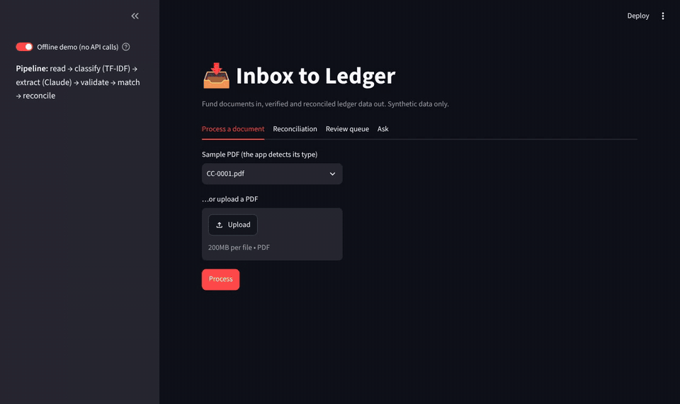
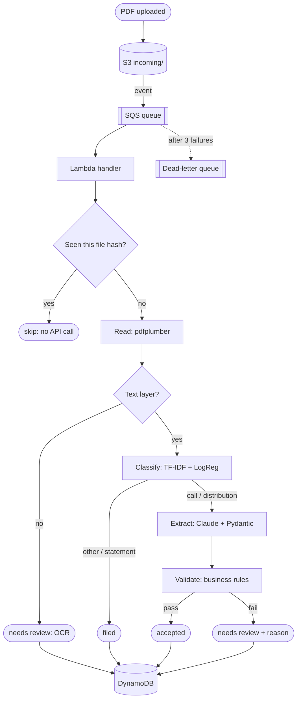
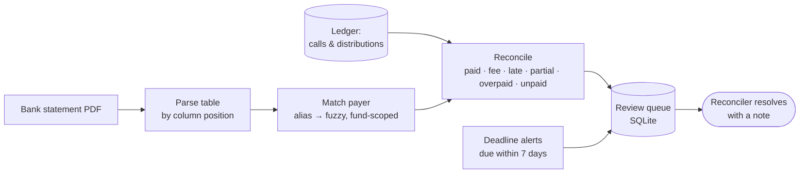

# 📥 Inbox to Ledger

**Fund documents in, verified and reconciled ledger data out, with a person kept in the loop for anything uncertain.**

An AI pipeline for private-fund administration. It reads capital call notices, distribution notices and bank statements, extracts the data with Claude, checks it against business rules, matches payments to investors, reconciles the bank against the ledger, and puts every exception in a prioritised review queue. It runs locally, in a Streamlit app, and as an event-driven serverless system on AWS.

   

<!-- DEMO GIF: record ~20 s of the Streamlit app (process a document → reconciliation → review queue) and save as docs/demo.gif -->



---

## Why I built this

Fund administrators receive thousands of documents (capital calls, distribution notices, bank statements) in every format imaginable. Keying them in by hand is slow, and a single wrong digit or a payment matched to the wrong investor can surface weeks later in a client's capital account. This project asks: **how much of that can AI handle safely, and how do you make sure it says so when it can't?**

## What it does

| Stage         | What happens                                                                  | How                                                                                   |
| ------------- | ----------------------------------------------------------------------------- | ------------------------------------------------------------------------------------- |
| **Read**      | PDF to text; scanned images are flagged for OCR                               | `pdfplumber` with layout preserved                                                    |
| **Classify**  | Capital call, distribution, bank statement, or other                          | TF-IDF + logistic regression, with a confidence threshold                             |
| **Extract**   | Fund, investor, amount, dates, reference                                      | Claude with a forced tool call + Pydantic schema                                      |
| **Validate**  | Known investor? Within commitment? Duplicate? Dates sensible?                 | Business rules in plain Python                                                        |
| **Match**     | Who is "CASSANDRATON PENSION P" on a bank line?                               | Exact alias → fuzzy match on the distinctive name, restricted to the fund's investors |
| **Reconcile** | Ledger vs bank: paid, paid less fee, late, partial, overpaid, unpaid          | Bank table read by column position; exact `Decimal` arithmetic                        |
| **Review**    | One prioritised queue of everything that needs a person, plus deadline alerts | SQLite, with no duplicates, an audit trail and auto-close                             |
| **Ask**       | Questions about the documents, answered with citations or "I can't find that" | Retrieval (TF-IDF) + Claude; no valid citation, no answer                             |

## Architecture

**Per document (runs locally, in the app, or in AWS Lambda):**



**Reconciliation and review (batch):**



**AWS (one `template.yaml`, deployed with AWS SAM):** S3 (private, encrypted, versioned) → SQS (+ dead-letter queue) → Lambda container (arm64) → DynamoDB. The API key lives in SSM Parameter Store; IAM permissions are least-privilege.

## Results

Everything is measured. The headline number at every stage is **silent errors**: wrong data accepted _without_ a flag. A flag costs a person a minute; a silent error puts wrong data in the ledger.

| Stage                        | Test set                                                                                                                         | Result                                                                                           |
| ---------------------------- | -------------------------------------------------------------------------------------------------------------------------------- | ------------------------------------------------------------------------------------------------ |
| Classification               | 39 held-out documents                                                                                                            | 100% accuracy, lowest confidence 0.83                                                            |
| Extraction                   | 30 held-out documents, 168 fields                                                                                                | 168/168 fields correct                                                                           |
| Extraction, **hard set**     | 40 documents built to break it: unseen layouts, OCR noise, amounts in words, prompt injection, missing fields, scans, duplicates | **40/40 handled correctly, 0 silent errors** (first run: 28/40; see Lessons)                     |
| Investor matching            | 154 real bank lines + 648 name variants (cut-off, typos, near-misses, wrong fund) on separate dev/test sets                      | 796/802 correct, 6 typos sent for review, **0 silent**                                           |
| Reconciliation               | 10 bank statements, 154 lines                                                                                                    | 100/100 statuses correct; 154 lines → **18 breaks** for review                                   |
| Reconciliation, **hard set** | Overpayments, duplicate wires, split payments, wrong references, fee boundaries, 2-page statement                                | 78 correct, 22 flagged, **0 silent, 0 false alarms**; same on 3 fresh seeds                      |
| Review queue                 | 61 consecutive mornings replayed                                                                                                 | No duplicates, human decisions never reopened, stale items auto-closed: all rules held every day |
| Ask (RAG)                    | 66 questions incl. 10 unanswerable and 1 conflict                                                                                | 65 correct, **0 silent**; all 10 unanswerable refused                                            |
| Cloud                        | 11 uploads to the deployed AWS stack                                                                                             | 11/11 correct, duplicate skipped, dead-letter queue empty                                        |

## Design decisions

- **LLM only where reading is needed.** Claude extracts fields from free-form documents. Classification, validation, matching and reconciliation are plain code: cheaper, deterministic, explainable.
- **Never guess.** Missing fields stay empty; Pydantic rejects incomplete forms; ambiguous matches go to a person.
- **Prompts ask, code enforces.** The forced tool call + Pydantic validate every extraction; Ask drops any citation of a document Claude wasn't given.
- **Money is exact.** `Decimal` everywhere, from generation to DynamoDB.
- **Measure, then decide.** Embeddings were _expected_ to beat keyword retrieval; measured, they didn't (53/57 vs 57/57 in the top 4), so Ask uses keyword retrieval.
- **Test on data the fixes never saw.** Hard sets for extraction, matching and reconciliation; separate dev/test sets; fresh seeds after fixing bugs.
- **Infrastructure as code.** The whole AWS system is one reviewable template, created or deleted with one command.

## Lessons (problems I hit and how I solved them)

The full log, with 25+ entries, is in [`LESSONS.md`](LESSONS.md). Highlights:

1. **12 silent errors on the hard set, all in one field.** I changed the evaluation to show expected vs got, which proved Claude was copying text after the reference (`JF CAP CALL 1 (drawdown no. 1)`). The root cause was my schema: it never said where a reference ends. One field description later: 28/40 → 40/40, original set still 168/168.
2. **"Lake Chad Insurance Co." matched Lake Chad Foundation.** Five different fuzzy scorers couldn't fix it, which proved it needed a rule: compare only the distinctive part of the name and reject a different kind of investor.
3. **A silent mislabel in reconciliation.** One investor received two distributions of exactly $577,500; the January wire was credited to the November one. Totals still balanced. Fix: same investor and amount → the item due closest to the payment date.
4. **A two-page statement crashed the reader.** Words were grouped by height on the page, ignoring which page they were on. Generated documents caught what unit tests didn't.
5. **My "test set" was secretly the dev set.** It came out almost identical, so 802/802 meant nothing. Made the sets genuinely different: 796/802.
6. **Ambiguous dates.** Claude repeated `02/07/2026` (July 2). A North American reads February 7. Prompt rule: write dates unambiguously.
7. **Cloud guardrails.** The AWS account's organization policy only allowed one region, and Lambda memory was capped at 512 MB. I read the full error, adapted, and rollback left nothing behind.

## Quick start

```bash
git clone https://github.com/mohamedhaibaa/inbox-to-ledger.git
cd inbox-to-ledger
python3 -m venv .venv && source .venv/bin/activate
pip install -r requirements.txt
python -m pipeline.classify          # train the classifier (a few seconds)
pytest -q                            # 66 tests, offline, no API key needed
streamlit run app/streamlit_app.py   # the app, in offline demo mode
```

To use Claude, copy `.env.example` to `.env` and add your Anthropic API key. Then:

```bash
python -m pipeline.process data/generated/capital_calls/CC-0001.pdf   # one document end to end
python -m eval.hard                                                   # the hard set (~37 API calls)
python -m eval.reconciliation                                         # no API calls
python -m pipeline.daily 2026-07-01                                   # the review queue for one morning
```

Deploy to AWS (needs Docker and the AWS SAM CLI): store the key with `aws ssm put-parameter --name /inbox-to-ledger/anthropic-api-key --type SecureString ...`, then `sam build && sam deploy --guided`.

## Project structure

```
pipeline/     read · classify · extract · validate · match · statement · reconcile · review · daily · ask · process
cloud/        Lambda handler and its slim requirements
app/          Streamlit UI
eval/         every evaluation script and its saved results (eval/results/)
data/         generators, master data, and the synthetic documents with answer keys
tests/        66 tests (moto fakes AWS; a fake client stands in for Claude)
template.yaml AWS infrastructure (SAM)   ·   Dockerfile   Lambda container image
```

## Limitations

- **Synthetic data.** I wrote both the generators and the pipeline. Hard sets reduce that bias but don't remove it; real documents will be messier.
- **Split payments and wrong references are flagged, not understood.** They show as two linked problems a person connects; suggesting the link is the next step.
- **Conflicting documents are refused, not explained** (1 case). A proper fix needs a conflict test set first.
- **No OCR yet.** Scanned PDFs are detected and sent for review.
- **Region.** Deployed in us-east-2 because the AWS account only allows that region; a Canadian deployment would use ca-central-1.

## How this was built

Every step was run, tested and checked on my machine: every result in this README comes from my own runs, and every failure in the Lessons section is one I hit and debugged. The evaluation harness exists precisely so that nothing, AI-written or not, is trusted without measurement.

---

_All data is synthetic. No real funds, investors or client documents were used._
